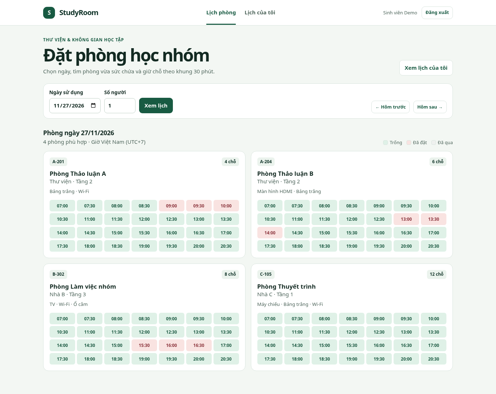
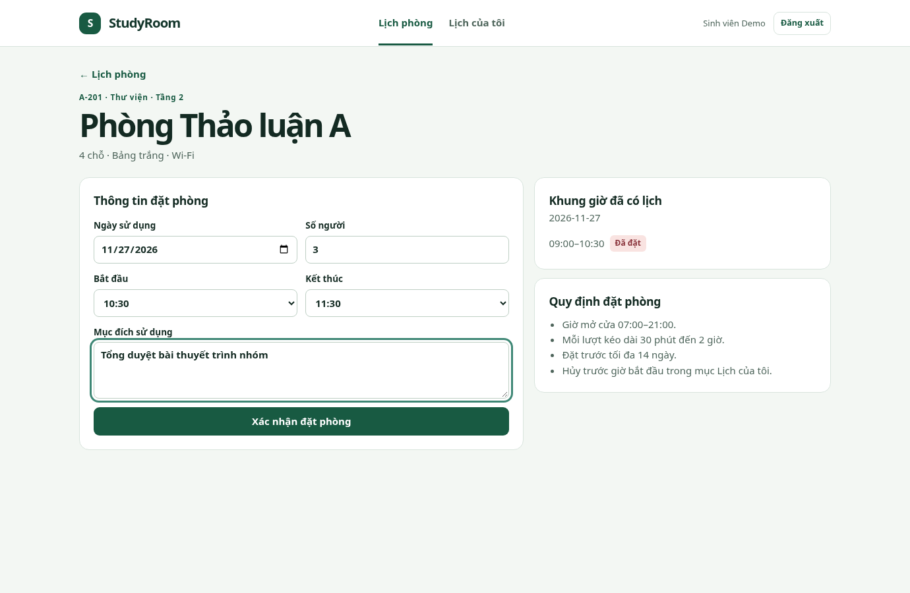
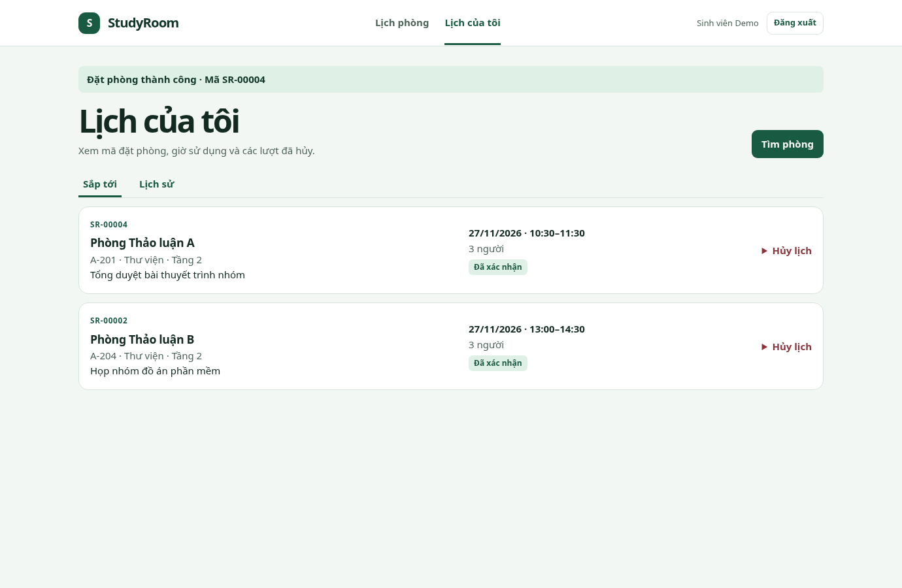

# StudyRoom — Đặt lịch phòng học nhóm

StudyRoom is a Flask booking app for campus study spaces. Students can browse a daily schedule, filter rooms by capacity, reserve an available room and cancel their own reservation. A database constraint prevents overlapping reservations even when two users submit at the same time.

**Công nghệ:** Python 3.11+, Flask, SQLAlchemy, Jinja, HTML/CSS, SQLite cho demo và cấu hình SQL Server qua ODBC.



| Biểu mẫu đặt phòng | Lịch của tôi |
| --- | --- |
|  |  |

## Chạy nhanh trên Mac

Giải nén ZIP và mở Terminal tại thư mục **StudyRoom** có `requirements.txt`. Dùng Python 3.12 nếu đã cài để chạy ProCheck:

```zsh
test -f requirements.txt &&
python3.12 -m venv .venv &&
./.venv/bin/python -m pip install -r requirements.txt &&
cp -n .env.example .env &&
./.venv/bin/python -c 'from dotenv import dotenv_values, set_key; from secrets import token_hex; key = dotenv_values(".env").get("SECRET_KEY") or ""; set_key(".env", "SECRET_KEY", key if len(key) >= 32 else token_hex(32))' &&
./.venv/bin/python -m flask --app studyroom init-db &&
./.venv/bin/python -m flask --app studyroom seed-demo &&
./.venv/bin/python -m flask --app studyroom run --port 5051
```

Mở [http://127.0.0.1:5051](http://127.0.0.1:5051). Tài khoản demo local là **`demo`**, mật khẩu **`StudyRoom-Demo26!`**. Chọn **Hôm sau** để thấy các khung mẫu. Dùng **Đăng ký** để tạo tài khoản riêng. Dữ liệu SQLite nằm ở `instance/studyroom.sqlite`. Lần sau chỉ chạy dòng `run` cuối.

## Chạy trên Windows

Trong PowerShell, chạy:

```powershell
py -m venv .venv
.\.venv\Scripts\python.exe -m pip install -r requirements.txt
Copy-Item .env.example .env
.\.venv\Scripts\python.exe -c "import secrets; print(secrets.token_hex(32))"
```

Ghi chuỗi mới sinh vào `SECRET_KEY=` trong `.env`. Nếu dùng SQLite thì giữ cấu hình mặc định. Nếu dùng SQL Server Express, cài Microsoft ODBC Driver 18, cài thêm `-r requirements-mssql.txt`, chạy `database/create_database.sql` trong SSMS, đổi `DATABASE_BACKEND=mssql` và cập nhật tên SQL Server trong `MSSQL_ODBC_CONNECTION`. Cấu hình mẫu Windows Authentication dành cho máy local.

```powershell
.\.venv\Scripts\python.exe -m flask --app studyroom init-db
.\.venv\Scripts\python.exe -m flask --app studyroom seed-demo
.\.venv\Scripts\python.exe -m flask --app studyroom run --port 5051
```

## Cách dùng và quy định

1. Đăng nhập và chọn ngày, số người. Mỗi phòng hiển thị sức chứa, vị trí, thiết bị và lịch theo mốc 30 phút.
2. Bấm một khung còn trống, chọn giờ kết thúc, nhập mục đích và xác nhận. Mã `SR-xxxxx` xuất hiện trong **Lịch của tôi**.
3. Giờ mở cửa **07:00–21:00**, theo giờ Việt Nam. Mỗi lượt từ **30 phút đến 2 giờ**, đặt trước tối đa **14 ngày**. Hai lượt liền kề trong cùng phòng hợp lệ nếu giờ kết thúc của lượt đầu đúng bằng giờ bắt đầu của lượt sau.
4. Chỉ chủ lịch có thể hủy trước giờ bắt đầu. Lịch hủy được lưu trong **Lịch sử**, còn các khung giờ được mở lại ngay sau khi giao dịch hoàn tất. Lịch chung hiển thị tình trạng đặt, còn mục đích và mã đặt chỉ hiện cho chủ lịch.

**Kịch bản demo:** Ở ngày mai, phòng A-201 đã có lịch mẫu 09:00–10:30. Chọn giờ bắt đầu 10:30 rồi đổi thành 10:00 và kết thúc 11:00 để thấy báo trùng. Đổi lại 10:30–11:30 để đặt thành công. Hủy từ **Lịch của tôi** rồi quay về lịch phòng để thấy chỗ mở lại.

## Điểm nhấn kỹ thuật

- **Chống trùng từ tầng database.** Một lịch được chia thành các khung 30 phút. Khóa chính `(room_id, day, minute)` của `occupied_slots` cho phép một lịch giữ mỗi khung tại một thời điểm.
- **Giao dịch nguyên tử.** Báo cáo đặt phòng và các khung giữ chỗ được ghi cùng nhau. Nếu trùng, giao dịch hoàn tác. Khi hủy, trạng thái và các khung đã giữ cũng được cập nhật trong cùng giao dịch.
- **Bảo vệ dữ liệu.** Băm mật khẩu bằng scrypt, kiểm tra CSRF cho biểu mẫu POST, lọc truy vấn theo chủ lịch, Jinja escape dữ liệu người dùng và giới hạn số lần thử đăng nhập theo IP trong từng tiến trình.

| Tệp | Nội dung |
| --- | --- |
| `studyroom/models.py` | Người dùng, phòng, lịch đặt và khung giờ giữ chỗ |
| `studyroom/booking.py` | Lịch phòng, xác thực thời gian, đặt và hủy |
| `studyroom/auth.py` | Đăng ký, đăng nhập và phiên người dùng |
| `studyroom/commands.py` | Khởi tạo bảng, danh sách phòng và dữ liệu mẫu |
| `tests/test_app.py` | Kiểm thử chức năng và tình huống hai phiên tranh cùng khung |

Chạy test tại thư mục gốc:

```sh
./.venv/bin/python -m unittest discover -s tests -v
```

Bản này phục vụ demo local. Bộ kiểm thử dùng SQLite tạm. Cấu hình và lược đồ SQL Server được cung cấp để chạy trên máy có SQL Server Express và ODBC Driver 18.
